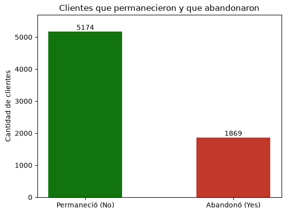
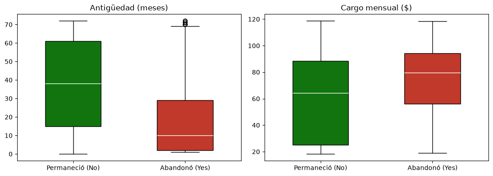
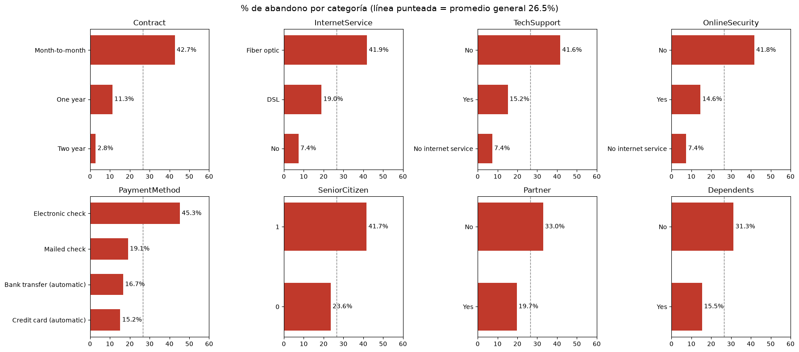

# Predicción de abandono de clientes (Customer Churn) con Regresión Logística

**Trabajo Práctico II – Prácticas Profesionalizantes I (Aproximación al Campo Laboral)**
Instituto Nuevos Aires · Tecnicatura Superior en Ciencia de Datos e Inteligencia Artificial
Estudiante: **Lucas Pérez Amador** · Docente: MSc. Ángel Daniel Fuentes S.

> Este repositorio publica un proyecto desarrollado durante la carrera (TP N° 2 de *Desarrollo de Sistemas de Inteligencia Artificial*) y contiene la reflexión teórica sobre Scrum pedida en este TP: [`respuestas_scrum.md`](respuestas_scrum.md).

---

## 1. Descripción general del proyecto

Una empresa de telecomunicaciones pierde clientes todos los meses, y retener a un cliente cuesta menos que conseguir uno nuevo. El objetivo del proyecto es **predecir si un cliente va a abandonar la compañía** a partir de su antigüedad, los servicios que contrató, el tipo de contrato y su facturación, e **identificar qué características se relacionan con el abandono**.

Es un problema de **aprendizaje supervisado de clasificación binaria** (abandona / no abandona), resuelto con **Regresión Logística**.

**Etapas del trabajo:**

1. Carga y exploración de los datos (forma, tipos, valores faltantes, distribución de la variable objetivo).
2. Preparación: selección de 11 variables, tratamiento de 11 valores vacíos ocultos en `TotalCharges` y codificación de las variables categóricas (`get_dummies`).
3. División entrenamiento / prueba (80 / 20, estratificada).
4. Construcción y entrenamiento del modelo (`StandardScaler` + `LogisticRegression` en un `Pipeline`).
5. Evaluación: exactitud, comparación con la línea base, análisis de errores y casos puntuales.
6. Conclusiones y limitaciones.

**Dataset:** [Telco Customer Churn – Kaggle](https://www.kaggle.com/datasets/blastchar/telco-customer-churn) · 7.043 clientes · 21 columnas · variable objetivo `Churn` (Yes / No).

## 2. Tecnologías utilizadas

| Tecnología | Uso |
|---|---|
| Python 3 | Lenguaje del proyecto |
| Jupyter Notebook | Desarrollo y documentación paso a paso |
| pandas | Carga, exploración y preparación de los datos |
| matplotlib | Gráficos exploratorios |
| scikit-learn | `train_test_split`, `StandardScaler`, `make_pipeline`, `LogisticRegression`, métricas |
| Git y GitHub | Control de versiones y publicación del proyecto |

## 3. Estructura del repositorio

```
tp2_ina_scrum_git/
├── README.md                     ← este documento
├── respuestas_scrum.md           ← Parte 2: reflexión teórica sobre Scrum
├── requirements.txt              ← librerías necesarias
├── .gitignore
├── data/
│   └── Telco_Customer_Churn.csv  ← dataset (Kaggle)
├── notebooks/
│   └── TP2_Churn_Regresion_Logistica.ipynb   ← código del proyecto
├── docs/
│   └── TP2_Informe_RL.pdf        ← informe del proyecto original
└── img/                          ← gráficos usados en este README
```

## 4. Instrucciones para ejecutar el código

**Requisitos:** Python 3.10 o superior y Git.

```bash
# 1. Clonar el repositorio
git clone https://github.com/Lucasplpa/tp2_ina_scrum_git.git
cd tp2_ina_scrum_git

# 2. (Opcional) Crear y activar un entorno virtual
python -m venv .venv
# Windows:
.venv\Scripts\activate
# Linux / macOS:
source .venv/bin/activate

# 3. Instalar las dependencias
pip install -r requirements.txt

# 4. Abrir el notebook
jupyter notebook notebooks/TP2_Churn_Regresion_Logistica.ipynb
```

Dentro de Jupyter: **Kernel → Restart & Run All**. El notebook lee el dataset desde `../data/Telco_Customer_Churn.csv`, así que hay que abrirlo desde la carpeta `notebooks/` (como en el paso 4).

**Alternativa sin instalar nada:** subir el notebook y el CSV a [Google Colab](https://colab.research.google.com/), dejar ambos archivos en la misma carpeta y cambiar la ruta de lectura a `'Telco_Customer_Churn.csv'`.

## 5. Capturas y ejemplos de resultados

### Distribución de la variable objetivo
Las clases están desbalanceadas: el 73,46 % de los clientes permanece y el 26,54 % abandona. Un modelo que respondiera siempre "No abandona" acertaría el 73,46 %: esa es la **línea base** que hay que superar.



### Antigüedad y cargo mensual según abandono
Quienes abandonan llevan **menos tiempo** en la empresa y pagan **más por mes**.



### Porcentaje de abandono por categoría
El abandono es mucho mayor con **contrato mes a mes** (42,7 % contra 2,8 % en contratos de dos años), **fibra óptica**, **sin soporte técnico ni seguridad en línea** y **pago con cheque electrónico**.



### Resultados del modelo

```
Exactitud en prueba:        79.84%   (1.125 aciertos de 1.409 clientes)
Exactitud en entrenamiento: 79.84%   → no hay sobreajuste
Línea base (siempre "No"):  73.46%   → el modelo la supera en 6,4 puntos

Abandonaron y el modelo predijo que NO:     171
No abandonaron y el modelo predijo que SÍ:  113
Abandonos detectados:                       203 de 374 (54 %)
```

Ejemplos de predicciones sobre clientes del conjunto de prueba:

| Registro | Antigüedad | Contrato | Internet | Prob. abandono | Real | Predicción | Resultado |
|---|---|---|---|---|---|---|---|
| 3524 | 11 meses | Mes a mes | Fibra óptica | 0,62 | Abandonó | Abandonó | ✅ Correcta |
| 437 | 72 meses | Dos años | Fibra óptica | 0,04 | No abandonó | No abandonó | ✅ Correcta |
| 1639 | 17 meses | Mes a mes | DSL | 0,45 | Abandonó | No abandonó | ❌ Falso negativo |
| 2280 | 8 meses | Mes a mes | Fibra óptica | 0,58 | No abandonó | Abandonó | ❌ Falso positivo |

## 6. Conclusiones personales

- **El problema va antes que el código.** Entender qué significa "abandonar" para el negocio y por qué importa más detectar a quien se va que acertar en general cambió la forma en que evalué el modelo: el 79,84 % de exactitud se ve bien, pero detecta solo el 54 % de los abandonos.
- **Explorar los datos evita errores silenciosos.** `isnull()` no mostraba faltantes, pero `TotalCharges` tenía 11 espacios en blanco. Revisar tipos de datos y casos puntuales fue tan importante como entrenar el modelo.
- **Siempre hay que compararse con una línea base.** Sin el 73,46 % de "responder siempre No", el resultado no tiene contexto.
- **Un modelo simple e interpretable también sirve.** La regresión logística no da solo una clase: da una probabilidad, y eso permite priorizar acciones de retención.